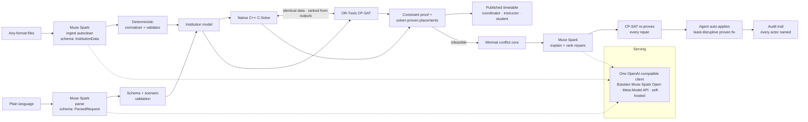

# Submission packet — Meta Global AI Developer Hackathon

Copy-paste source for the CV platform form. Deadline: **Wed Nov 4, 9:00 PM ET**
(claim Meta credits by the same time). One submission per team.

## Form fields

| Field | Value |
|---|---|
| Project name | ScheduleSolve AI |
| Track | **Indie Developer** (solo entrant) |
| Problem statement | **Build for Your World** — the course-timetabling week every department coordinator loses, every term |
| Team | Solo — Huong Le |
| Repo (public) | https://github.com/prohle/schedulesolve-ai |
| Demo video | https://github.com/prohle/schedulesolve-ai/releases/download/demo-video/final.mp4 (3:01 live Puppeteer screencast, re-recorded Nov 2 live against Muse Spark Open on Baseten — every Muse beat asserts the `meta-models/muse-spark-open-1026` badge on screen, never a fallback; narration byte-identical to the final pitch, 12 beats) — _upload the same file to YouTube and add that link here too_ |
| Live demo | **https://prohle--schedulesolve-ai-ui-web.us-east.modal.run** (full UI, sample-account login, no API key; backend API: https://prohle--schedulesolve-ai-api.us-east.modal.run/docs). Chat runs on **open-weight Muse Spark Open** `meta-models/muse-spark-open-1026` via Baseten; voice ASR stays on the Meta Model API. A durable daily model budget + per-identity rate limits protect the demo from credit-drain bots, and budget exhaustion degrades to the labelled deterministic fallback instead of breaking a judge's flow. Or judges run `docker compose up` (no key, no account — see README "Judges — try it in 2 minutes") |
| X post (Most Viral) | _paste link after posting; engagement counts until Nov 8 EOD. Ready copy below — attach `final.mp4`_ |

**X post (ready to publish, attach the video):**
> Every term, one coordinator loses a week to the course timetable. ScheduleSolve AI takes the messy files as they are — PDF, Word, Excel, scans, plain text — and returns a *proven* timetable for the whole university. The AI proposes. The solver proves. Our own C++ solver proves the same answer faster on every measured instance — and finishes a 361-section university the industrial engine can't. Runs on Meta's open-weight Muse Spark Open via Baseten. Live demo + full build log in the replies. #BuildForYourWorld #MetaHackathon
>
> Reply 1: Live demo (sample-account login, no API key): https://prohle--schedulesolve-ai-ui-web.us-east.modal.run
> Reply 2: Code + evidence: https://github.com/prohle/schedulesolve-ai

**One-liner:** An agentic co-pilot that turns natural-language scheduling
constraints into a provably feasible university timetable — Muse Spark
proposes typed constraints, two solver engines (OR-Tools CP-SAT and an
AI-authored native C++ rival) prove every schedule, coverage swap, repair,
and student's personal plan before it can stand.

**Short description (form):**
Every term, a department coordinator burns a week reconciling instructor
constraints, degree roadmaps, room capacities, and campus walk times in a
spreadsheet that is wrong the moment reality changes. This is not an
"AI for education" chatbot: the model never writes the schedule. ScheduleSolve AI replaces
that week: paste or drop the institution's messy data and Muse Spark
autocleans it into a typed model; type one sentence ("Prof. Patel can't teach
Mondays — committee duty") and Muse parses it into validated constraints
while CP-SAT re-solves and proves the ripple; when reality breaks mid-term, a
one typed message ("Prof. Chen will no longer teach this term") triggers CP-SAT probes of every
qualified instructor and only zero-ripple-verified coverage is shown. When a
request is infeasible, CP-SAT names the minimal conflicting subset, Muse
translates the proof into ranked resolutions, and CP-SAT re-solves every one
before the least disruptive is auto-applied. At department scale (26
instructors, 25 sections, 12 cohorts, 3 programs) the same engines solve
optimally in tens of milliseconds with the four-course guarantee holding
for all 12 cohorts. And the proof runs both ways: a student is advised
from their own study record and desired degree — mandatory vs optional
from the institution's degree map, completed courses from the record
they provide (or a cohort progress lookup when they don't), then "I work
Tue/Thu, I need CS 201, no 8 AMs" — and gets a personal plan selected
from the placed timetable and re-verified before it is shown, or an
honest explanation of why their must-take course cannot fit this term. The
same panel projects the graduation term from the degree-map chain, completed
record, locked prerequisites and the verified plan — "On track for Spring
2029" or "CS 401 pushes graduation +1 term." Contradictory inputs are never
resolved silently: a record that disagrees with the cohort lookup, a
must-take course that only meets inside an unavailable block, or "I need
CS 201" when CS 201 is already completed each return a named conflict with
both options, and the student chooses which wins; the response also names
the input that is missing (e.g. an individual study record) so the
projection can be made exact. The LLM
never touches the schedule — it proposes; the solver proves; every step
is in the audit trail.

## Pitch (canonical — use this text for the video narration and the form)

Think back to when you were a student. Just registering for your classes was
an exercise in survival. You're juggling your degree roadmap, trying to
graduate on time, working a weekday job, and praying prerequisites don't
collide so you don't slip a semester. Getting your schedule right was hard
enough.

But what happens when you step into the registrar's chair? Suddenly, you
aren't solving for one schedule — you're building the heartbeat for an
entire university. You need to satisfy thousands of students navigating
graduation roadmaps, keep dozens of faculty happy with load caps and
committee duties, and maximize fixed room capacities across a campus you
can't cross in ten minutes.

Right now, universities solve this NP-hard combinatorial puzzle with email
threads, guesswork, and spreadsheets that are broken the moment reality
changes. To fix this for the Meta Hackathon, we built ScheduleSolve AI.

Here is how it works. You point the tool at messy institutional files in any
format — PDF catalogs, Word degree maps, Excel room sheets, or plain text.
Muse Spark — Meta's model family, and the intelligence layer behind
ScheduleSolve AI — autocleans and organizes them into cleaned structured data
representing the entire institution: for each degree roadmap, current
student bodies, current faculty load requirements, faculty preference and
availability, each cohort based on real map and lab facility availability,
offerings and room sizes.

Our NP-hard problem is then passed into three registered solver engines:
Google's industrial CP-SAT, an AI-authored native C++ rival solver we built
specifically for this problem class during the hackathon period which
proves the same optima faster on every measured instance, and a greedy baseline that
shows what the optimization phases buy. The two proving engines race
head-to-head on identical data.

At university scale — 38 instructors, 41 sections, 20 cohorts sharing rooms
and walk-time matrices — both engines return a mathematically proven,
conflict-free institutional timetable in milliseconds. The engines are
ranked from their outputs alone, and Muse Spark presents that verdict to
users. Users can request a re-run after keeping or refining the current
schedule. And the same engines scale: on our full-university stress
benchmark — 198 instructors, 361 sections, 100 cohorts, roughly twelve
thousand students — the native solver still proves the optimum in about
six seconds, a scale where CP-SAT exceeds its 60-second budget. What happens
when reality breaks mid-flight?

When Professor Chen will no longer teach this term — a change that lasts
through the end of the semester — the system doesn't collapse into panic.
It runs solver-verified coverage probes over every qualified instructor,
ranking them by preference and load delta. It proposes a zero-ripple fix
and re-solves instantly. The same is true when the university wants to
repurpose classrooms, add classes, or build more buildings for expansion.

If a coordinator tries an impossible override, the system uses assumption
literals to isolate the minimal conflict core. Muse Spark explains the
deadlock in plain English, and every single proposed repair is re-proven by
the solver before the agent is allowed to show it. The app is multi-user
role-filtered, backed by Postgres, and cuts weeks of manual coordinating
data to an auditable, sub-second review of solver-proven options. Students
get the same guarantee from the other side: state your work days and the
course you cannot miss, and the plan you are shown has already been proven
to fit both — or you are told, before registration, exactly why it cannot.

We took the universal pain of student scheduling, scaled it to
university grade, and married Meta's open-weights intelligence with hard
deterministic mathematics. Check out the live demo and the native C++
engine source code on GitHub. Thank you.

## Architecture (one diagram — who proposes, who proves)

**Read it as three lanes:** Muse Spark handles unstructured ingestion, constraint schema generation, and the plain-English explanation of the solver's proof. The deterministic engines (C++ C-Solve and OR-Tools CP-SAT) own feasibility, ranking, conflict cores, and every repair. The agent applies only what the solver has proved, and the trace names every actor.

## Meta AI tooling used (runtime — every runtime model is a Meta model)

> **Live demo configuration:** all five chat roles run on **open-weight Muse Spark Open** `meta-models/muse-spark-open-1026` served by **Baseten**; voice ASR runs on `muse-voice-transcribe-1.0` via the Meta Model API. The table below names the code path; the default `muse-spark-1.3-contributor` is for synthetic local runs, and the swap is environment-only (`MUSE_BASE_URL`, `MUSE_MODEL`, `MODEL_API_KEY`).

| Role | Model | Where |
|---|---|---|
| Ingestion autoclean → typed scenario | Muse Spark `muse-spark-1.3-contributor` | `backend/app/ingestion/parser.py` |
| Constraint parsing → typed operations | Muse Spark `muse-spark-1.3-contributor` | `backend/app/parsing/parser.py` |
| Self-heal explanation → ranked resolutions | Muse Spark `muse-spark-1.3-contributor` | `backend/app/agent/explainer.py` |
| Intelligence tightening → typed repair moves | Muse Spark `muse-spark-1.3-contributor` | `backend/app/intelligence/tightener.py` |
| Student plan → typed life constraints | Muse Spark `muse-spark-1.3-contributor` | `backend/app/parsing/student.py` |
| Voice note → reviewable text draft (never auto-applied) | Muse Voice Transcribe `muse-voice-transcribe-1.0` | `backend/app/services/voice.py` |

Live captured proof: `backend/muse-verification.json` (all structured roles,
real outputs + latencies) and `backend/muse-verification-student.json`
(student parse, verified end-to-end). No-key fallback is a deterministic
deterministic parser, so judges can click every beat offline.

## Bonus prizes — what to flag

- **Best Agentic Use-Case ($5K) — CLAIM.** The co-pilot runs an autonomous
  multi-step loop with tool use and self-correction: parse → validate →
  solve → minimal-conflict-core → explain → verify-every-resolution →
  auto-apply → re-solve → audit (up to 5 healing rounds), plus term change
  probe-and-choose across every qualified instructor. Every response carries
  the `agent_trace`; Guided build renders it live. That is the claim evidence.
- **Most Viral Project ($20K) — CLAIM VIA X.** Post the 3-min demo on X,
  submit the post link on the platform; winner = total engagement
  (likes + reposts + comments) through **Nov 8 EOD**. Post at submission
  time, not after judging starts.
- **Community Vote ($10K) — automatic.** Project appears in the public
  gallery; winner announced Nov 16. Share the gallery link with the X post.
- **Best Build on Meta Open Weight Models ($10K) — CLAIM (verified Oct 29).**
  All four structured roles run on **Muse Spark Open**
  (`meta-models/muse-spark-open-1026`) served by Baseten ($100 hackathon
  credit, 2M TPM). Live captured proof: `backend/muse-verification-open.json`
  — 18/18 calls (12 parse, 3 explanation, 2 tighten, 1 ingestion) against
  `https://inference.baseten.co/v1`, real structured outputs + latencies.
  The swap is env-only (`MUSE_BASE_URL` + `MUSE_MODEL` + the Baseten key as
  `MODEL_API_KEY`); recording with it makes the on-screen badge read
  `muse-spark · meta-models/muse-spark-open-1026`. **The hosted demo is now
  deployed on this exact path** (verified Nov 2: `/runtime/config` reports
  provider Baseten, model `meta-models/muse-spark-open-1026`, live=true), so
  the infrastructure partner can verify the live product, not only the
  recording.
- **Best Creative Build ($5K) — do not claim** (no Muse Image/Wonder surface;
  a false flag wastes reviewer attention).

## How this maps to the rubric (Stage 2)

| Criterion (weight) | Evidence a judge can check in <5 min |
|---|---|
| Impact (30%) | Coordinator-week → minutes, quantified in README "Proof at university scale" + benchmark script; real domain (degree roadmaps, walk matrix, prep caps) at three measured scales — department (26 instructors), university (38), and a full-university stress instance (198 instructors · 361 sections · 100 cohorts · ~12,000 students); students get the same proof in reverse — a personal plan that fits their job and degree roadmap, an honest warning before a must-take course slips a semester, and a projected graduation term that names the course that pushes it out |
| Use of Meta AI tooling (25%) | 5 runtime Muse Spark roles (ingest, parse, explain, tighten, student plan) + Muse Voice Transcribe as a draft-only input (identity comes from the signed-in session — voice alone never changes the term), live badges (model + latency) on screen, `muse-verification.json` + `muse-verification-open.json` + `muse-verification-student.json`, agent trace names Muse at every proposing step |
| Technical depth & execution (20%) | AI-authored **native C++ rival solver proving CP-SAT's optimum faster** at every demo scale and the only engine to complete the **full-university stress instance (198 instructors · 361 sections · 100 cohorts · ~12,000 students; CP-SAT reports `unknown` inside its budget there)** (docs/solver_evidence.md, benchmark + parity tests), CP-SAT assumption-literal minimal conflict cores, feasibility probes, spectral (Laplacian/Fiedler/Hoffman/max-clique) warm-start + deadlock radar, C39 guarantee audit (100/100 at stress scale), **multi-user roles** (coordinator/instructor/student logins, published schedules, verified change requests, per-professor intake before the deadline — grid picks or plain English documented by Muse Spark, with an evidence gate: hard stays hard only with evidence attached, otherwise it is downgraded to the strongest soft preference — + term closures), **coordinator-owned academic policy** (student-credit load curve, research/teaching tracks, full-time thresholds), **catalog decisions** (not-offered/dormant/special topics with records), **PhD 1-3 credit Fall reservations** with supervisor caps, **national-holiday/term-date suggestions + day swaps**, **realism audit + seeded randomized solver performance record** (docs/data_realism_audit.md, docs/solver_performance.md), 131 passing tests, CI |
| Demo (25%) | Working live stack (`docker compose up`, Postgres 18), before/after zero-ripple term change, solver-verified resolutions, department-scale solve in the Build step; one-click proof JSON, downloadable agent trace, and calendar export (ICS) with holidays/closures excluded |

## What was built during the hackathon (Oct 27 – Nov 4)

Everything in the repo — solver, agent loop, intelligence layer, ingestion,
UI, ops (Docker/Postgres 18), tests. Commit history is the build log.

## Pilot outreach (human action — highest-ROI hour left)

The one score gap code cannot close is Impact evidence: the coordinator-week
baseline is currently an estimate. Two or three real replies change that.
Send this (adapt the bracket) to department coordinators / registrars you
can reach, and quote any reply (with permission) in the form's Impact field:

> Subject: 10-minute look — AI timetabling that proves its schedule?
>
> Hi [Name], I built ScheduleSolve AI for the Meta hackathon: it takes the
> messy files a department already has (catalog, degree maps, room sheets,
> faculty emails), turns natural-language constraints ("Patel can't teach
> Mondays") into a timetable a solver mathematically proves feasible, and
> re-proves every mid-term change before showing it. It also suggests
> students a personal course plan that fits their work schedule and degree
> roadmap — or warns them before a must-take course slips a semester.
> Live demo (no signup): https://prohle--schedulesolve-ai-ui-web.us-east.modal.run
> Would you be willing to look for 10 minutes and tell me (a) how long
> timetabling takes your office today, and (b) whether a proven schedule
> would change that? One quotable sentence helps more than any feature.

## Pre-submit checklist

- [x] All work committed and pushed; repo public and cloneable
- [x] `docker compose up --build` boots cleanly (db Postgres 18 → backend → frontend; verified Oct 30 with port overrides — UI 200, proxied scenario, both engines `optimal` penalty −6 inside the containers, native binary built in-image)
- [x] Backend tests pass (`cd backend && .venv/bin/python -m pytest -q` — 130 tests, verified Nov 2, incl. full-university stress scale)
- [x] Frontend production build passes (`cd frontend && npm run build`, verified Oct 30)
- [x] Video 3:01, re-recorded Nov 2 live against Muse Spark Open on Baseten — recorder asserts the live `muse-spark` + `meta-models/muse-spark-open-1026` badge at every Muse beat (a fallback fails the recording); frame-checked
- [x] Video shows, in order: any-format import autoclean (PDF/DOCX/CSV/TXT/XLSX/MD) → Patel intake applied to the term → **dual-engine compare at department scale, Rank 1 / Rank 2 from outputs (native solver first)** → university scale (38/41/20, asserted on screen) + publish → Chen change request approved and re-published → term change with agent trace + ranked verified reassignment → Diaz impossible override (conflict core + verified repairs) → capacity what-ifs + end card
- [x] Live demo deployed (Modal UI + API) and **redeployed Nov 2 with the current UI**, then the **backend redeployed again Nov 2 22:10 UTC from `996e31a`** so the live app runs the exact submitted tree — chat on open-weight Muse Spark Open via Baseten (`/runtime/config` re-verified after that deploy: provider Baseten, model `meta-models/muse-spark-open-1026`, live=true; a real `/runtime/test` returned schema-valid operations), sample login works, AI Runtime page shows the open-weight badge. Cost guard deployed and re-verified live (a 9,000-character message returns `413`, proving the guard build is serving): durable daily budget (`model_usage`), per-identity rate limits, request caps; budget exhaustion degrades to the labelled deterministic fallback. Scenario left reset to seed.
- [x] Student schedule suggestion shipped (Oct 30): Spark student parse live-verified (`muse-verification-student.json`), exact selector + independent re-verification, My Schedule student panel; 58 backend tests pass
- [x] Voice hardened to draft-only (Oct 30): `/term-change/audio` returns a transcript for a signed-in reviewer and never changes the term by itself — speaker identity cannot be established from audio
- [x] Claim consistency pass (Oct 30): test badge = 131, engine-speed claims aligned to `docs/solver_evidence.md` (same proven optimum, faster on every measured row; deterministic single-worker contract stated explicitly)
- [x] UX hardening (Nov 2): stable URLs and deep-link routing, role-scoped workspaces, coordinator role preview, first-run checklist, structured degree-map editor (no raw JSON), mobile task cards, skip link, focus-trapped More sheet, ARIA live toasts — Puppeteer walkthrough 21/21 at 1280px and 390px; `tsc`, production build and 131 tests green
- [x] Judging-week warmth is **manual-only** (`.github/workflows/keepwarm.yml`, `workflow_dispatch`): pinging a scale-to-zero app every 15 min pays a cold start per ping and cost ~$1.50–2.20 across judging week — more than the remaining credit. Cold start is ~10–20 s with a cached image; run the workflow manually right before a live demo. Cost math in `docs/deploy_modal.md`
- [x] README screenshots regenerated against the current Guided build UI (Nov 2, `local-demo/shots_new_ui.js` driving the live stack at 1440×900): Build timetable grid, Term change before/after, Insights audit ledger, student verified plan
- [x] Demo video re-recorded with the ScheduleSolve AI brand and Baseten live model (Nov 2): `local-demo/record_live.js` + `narrate.py` + `assemble_live.py`, narration byte-identical to `local_final_pitch.md`; upload `final.mp4` as the `demo-video` release asset — **account action at submit time**
- [ ] Meta credits claimed (deadline Nov 4, 9:00 PM ET); spend limit set — **account action**
- [ ] X post published with video + repo + gallery links; post link submitted (Most Viral cutoff Nov 8 EOD) — **account action** (copy ready above)
- [ ] YouTube upload of `final.mp4`; link added to the video field above — **account action**
- [ ] Submitted on the CV platform before **Nov 4, 9:00 PM ET** — not at 8:59 — **account action**
